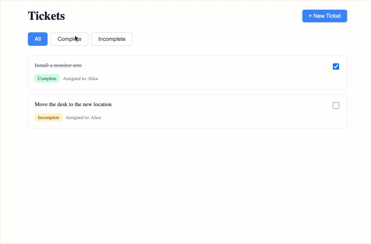

# Client

🎯 Key Features Implemented (Prioritization):

✅ Context API + useReducer - Centralized state management
✅ Custom Hooks - useTickets, useFilteredTickets, useFormValidation
✅ Optimistic UI Updates - Instant feedback with rollback
✅ AbortController - Proper race condition handling
✅ Form Validation - Real-time with error messages
✅ Responsive Design (Use CSS Modules for simplification)
✅ Cover Basic Tests: ticket list rendering, filter functionality & API error handling
✅ TypeScript - Full type safety
✅ Error Handling - User-friendly error messages
✅ Loading States - Spinners and pending states

🧩 Implementation Strategy:

### Setup

Review API
Set up routing structure
Create basic layout and navigation
Set up API service layer

### Core Features

List View:

Fetch and display tickets
Handle loading/error states
Implement status filter

Details View:

Display full ticket info
Add assign/complete functionality

Create Ticket:

Simple form with validation
API integration

Polish

Add loading spinners
Error handling and user feedback
Basic responsive design
Handle race conditions with abort controler

⚠️ Focus on using built-in features of React first
